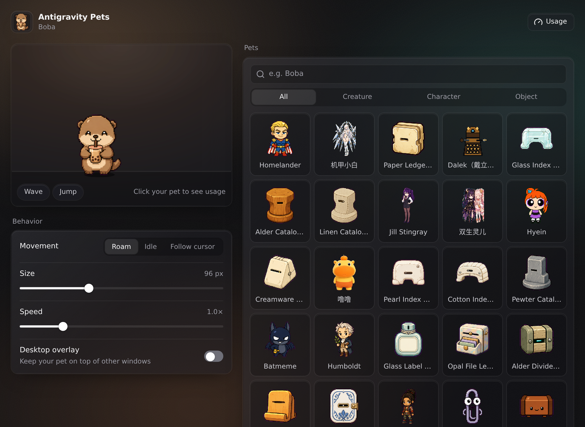
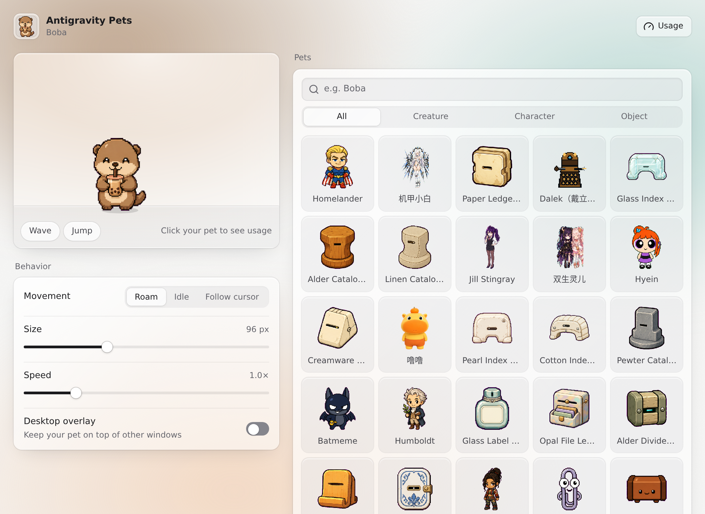
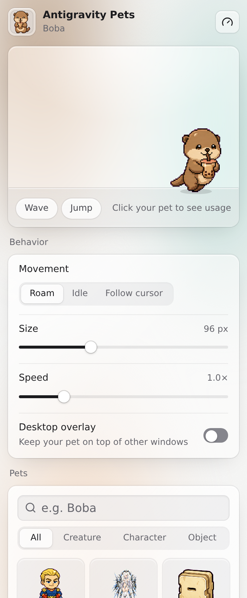
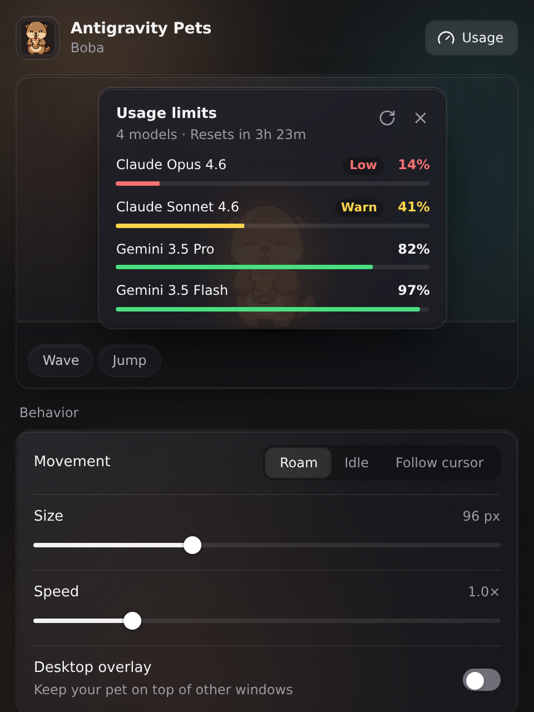

# Antigravity Pets (`agy-pets`)

Pixel-art pets from [petdex.dev](https://petdex.dev) inside your Google Antigravity auxiliary pane, with a live model quota popover and an optional always-on-top Windows desktop overlay.



| Wide Light Pane | Narrow Auxiliary Pane | Model Quota Popover |
| :---: | :---: | :---: |
|  |  |  |

## Features

- **Responsive sidecar layout**: Scales with the auxiliary pane. Narrow panes stack the stage, controls, and catalog in one column; wider panes (`680 px+`) place the stage and behavior controls alongside the pet catalog.
- **Frosted glass cards**: Translucent surfaces blur an ambient backdrop that samples its accent color from the active pet's sprite. Adapts to system light and dark themes and `prefers-reduced-motion`.
- **Live model quota**: Click your pet (or **Usage**) to query the local Antigravity Language Server (`GetUserStatus`) for remaining quota per model and reset countdowns.
- **5,200+ petdex.dev sprites**: Search by name or creator, filter by kind (`Creature`, `Character`, `Object`), and cache manifests and WebP spritesheets locally under `sidecars/pets/cache/`.
- **Windows desktop overlay**: Toggle **Desktop overlay** to spawn a transparent, always-on-top WPF window (`overlay/AgyPetsOverlay.csproj`). Drag to move the pet across your screen, left-click for quota, or right-click for the tray menu.

---

## Setting Up on Another Device

`agy-pets` has no npm runtime dependencies. The sidecar runs directly on Antigravity's bundled Node.js runtime and `sidecar_sdk`.

### Option 1: Clone into your global plugins directory

Clone this repository into Antigravity's plugin discovery path:

**macOS / Linux**

```bash
mkdir -p ~/.gemini/config/plugins
git clone https://github.com/hongyaok/agy-pets.git ~/.gemini/config/plugins/agy-pets
```

**Windows (PowerShell)**

```powershell
New-Item -ItemType Directory -Force "$env:USERPROFILE\.gemini\config\plugins" | Out-Null
git clone https://github.com/hongyaok/agy-pets.git "$env:USERPROFILE\.gemini\config\plugins\agy-pets"
```

Then enable the plugin sidecar in `~/.gemini/config/config.json` (`%USERPROFILE%\.gemini\config\config.json` on Windows):

```json
{
  "sidecars": {
    "agy-pets/pets": {
      "enabled": true
    }
  }
}
```

Restart Antigravity (or toggle **Antigravity Pets** under **Customizations → Installed** in the left sidebar).

### Option 2: Install with the Antigravity CLI

```bash
agy plugin install https://github.com/hongyaok/agy-pets
```

Or run `/plugin install https://github.com/hongyaok/agy-pets` inside an Antigravity chat session.

### Option 3: Workspace-only install

To bundle the plugin inside a single project so anyone cloning that repo gets it automatically:

```bash
mkdir -p .agents/plugins
git clone https://github.com/hongyaok/agy-pets.git .agents/plugins/agy-pets
```

### Windows Desktop Overlay Setup (Optional, Windows 10/11)

The sidecar panel works on macOS, Linux, and Windows out of the box. To use the floating desktop pet on Windows, install the [.NET 10 Desktop SDK](https://dotnet.microsoft.com/download/dotnet/10.0) and build the WPF executable once:

```powershell
cd "$env:USERPROFILE\.gemini\config\plugins\agy-pets\overlay"
dotnet build -c Release
```

This produces `overlay/bin/Release/net10.0-windows/AgyPetsOverlay.exe`, which the sidecar launches when you flip the **Desktop overlay** switch. If you skip the prebuild, the sidecar falls back to `dotnet run --project overlay -c Release`.

---

## Opening the Panel

Once installed, open the sidecar in any of three ways:

1. Ask the agent **"Open Antigravity Pets"** (which surfaces `[Open Antigravity Pets](sidecar://agy-pets/pets/)`).
2. Click **Antigravity Pets** in the Auxiliary Side Pane header.
3. Invoke the `/agy-pets` skill in chat.

---

## Repository Layout

```text
.
├── plugin.json                 # Antigravity plugin manifest
├── skills/
│   └── agy-pets/
│       └── SKILL.md            # On-demand skill instructions
├── sidecars/
│   └── pets/
│       ├── sidecar.json        # Sidecar process + AUX_PANE UI registration
│       ├── main.mjs            # Node.js backend (manifest/sprite cache, config, LS quota, overlay)
│       └── index.html          # Self-contained sidecar UI
└── overlay/
    ├── AgyPetsOverlay.csproj   # Windows WPF desktop overlay (.NET 10)
    ├── App.xaml(.cs)
    └── MainWindow.xaml(.cs)
```
